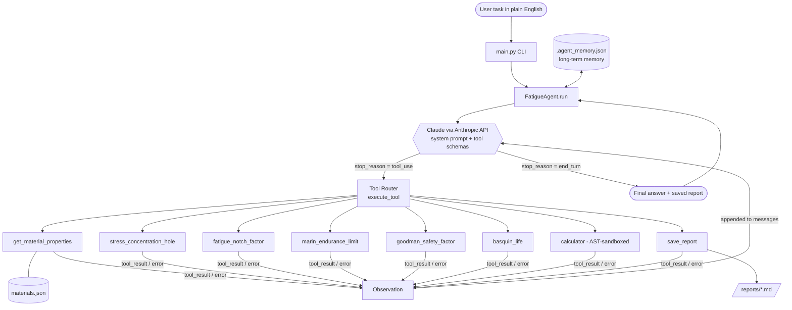

# Architecture Schema - Fatigue Design Agent

## Agent loop (ReAct: Plan -> Act -> Observe -> Reflect)
1. **Plan** - model writes a numbered plan from the task.
2. **Act** - model emits one or more `tool_use` calls (e.g. Kt -> Kf -> Se -> life).
3. **Observe** - `execute_tool` runs them; results (or errors) return as `tool_result`.
4. **Reflect** - model sanity-checks, retries on error, or calls more tools (max 12 steps).
5. **Report** - model calls `save_report`, then returns a summary.

## Components
| Component | Role |
|---|---|
| `agent.py` | Orchestrator loop, step limit, persistent memory |
| `tools.py` | 8 tools + JSON schemas + safe dispatcher with error feedback |
| `materials.json` | Material knowledge base |
| `.agent_memory.json` | Cross-session memory (last 5 tasks) |
